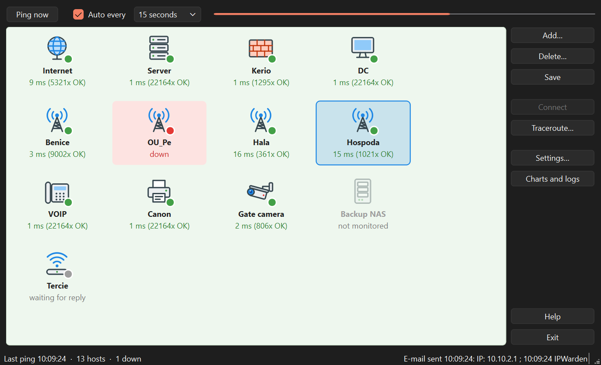

# Warden

**Network device availability monitor for Windows 10 and 11.** Warden regularly pings servers, routers, radio links,
printers and other devices. When one stops responding, it sends an alert by e-mail or SMS.

It is a modern replacement for **IPWatch 1.7 beta** from the Windows 7 era: the same way of working, plus support for
today's mail services, encryption, and both Czech and English.

[Česká verze](README.md)



## Features

- Monitors any number of hosts (IP address or computer name), pinging all of them in parallel so one dead host
  doesn't delay the others.
- Ping interval from 10 seconds to 1 hour, or manually with **Ping now**.
- Clear tiles with icon, response time in ms and the number of successful pings in a row. Outages turn red.
- **E-mail alerts** on outage and recovery, with a configurable number of failures so a single lost packet
  doesn't raise an alarm.
- **SMS** via your carrier's or SMS service's e-mail-to-SMS gateway.
- When the whole network goes down you get **one** "Network unreachable" e-mail instead of one per host.
- Presets for Seznam, Gmail and Outlook, plus a **Test SMTP** button that explains errors in plain language.
- **Response time charts**, an **outage log** (also opens in Excel) and **traceroute** to any host.
- Configuration export and import for moving to another computer.
- Start with Windows, Czech and English user interface, built-in help (F1).

## Download and installation

1. Open the **[Releases](https://github.com/Svandik42/Warden/releases)** page and download one file from the latest version:

   | file | for whom |
   |---|---|
   | `Warden-…-setup.exe` | **recommended**: regular installation with a Start menu shortcut |
   | `Warden-…-portable.zip` | no installation: unzip anywhere (even a USB stick) and run `Warden.exe` |

2. Run the installer and follow the wizard. It does not need administrator rights. At the end you can choose to start
   Warden with Windows.

3. Windows may show **"Windows protected your PC"** because the installer is not digitally signed.
   Click **More info** and then **Run anyway**.

**Requirements:** 64-bit Windows 10 or 11. Nothing else to install: no Python or other libraries are needed.

**Uninstalling:** Windows Settings → Apps → Warden → Uninstall. Your hosts and settings stay in `%APPDATA%\Warden` in
case you reinstall. Delete that folder if you don't need them.

## Quick start

1. **Add…**: enter the IP address or name of a device and a description. Repeat for all devices.
2. **Save**.
3. **Settings… → Recipients and message**: add the e-mail address that should receive alerts.
4. **Settings… → SMTP server**: choose your provider, enter your address and password, and click **Test SMTP**.
   Gmail (and Seznam with two-factor sign-in) requires an **app password**.

A detailed illustrated guide opens from the **Help** button or the **F1** key.

## How it works

```
Scheduler ──► Pinger (parallel) ──► Monitor ──► events (outage / recovery / network)
 (own thread,                         │              │
  every N s)                          │              └─► Notifier (queue) ──► SMTP ──► e-mail / SMS
                                      │                    retries after a minute on failure
                                      └─► window (tiles, status bar), history, log
```

- **Ping** uses ICMP through the `icmplib` library, without administrator rights. Each host has its own timeout.
- **Scheduler** runs in its own thread and pings all hosts in parallel each cycle, so a cycle takes as long as the
  slowest host, not the sum of all of them.
- **Monitor** counts successes and failures in a row. A host turns red after a set number of failures, the outage
  e-mail goes out after a further threshold, and a recovery e-mail is sent only if an outage e-mail was sent before.
  When most hosts fail at once, it reports a network outage instead of individual hosts.
- **Notifier** sends e-mails from its own thread through a queue, so a slow or unreachable mail server never delays
  pinging. Temporary errors (e.g. internet down) are retried; permanent ones (wrong password) are reported.
- **Data** is stored as JSON in `%APPDATA%\Warden`. Files are written atomically, so a power cut while saving cannot
  corrupt them. The SMTP password is encrypted with Windows DPAPI for your user account.

The application's source code is in this repository. It is written in Python with PySide6 (Qt).
