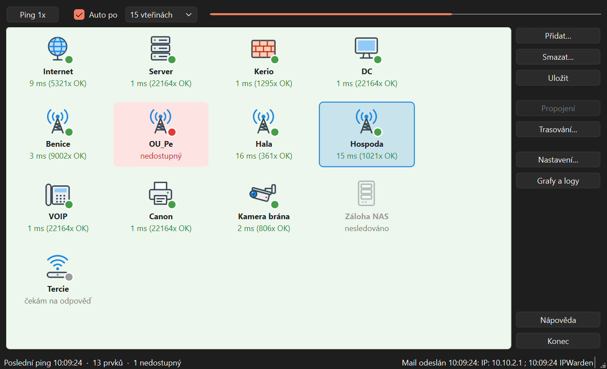

# Warden

**Hlídání dostupnosti síťových prvků pro Windows 10 a 11.** Warden pravidelně pinguje servery, routery, radiové spoje,
tiskárny a další zařízení. Když některé přestane odpovídat, pošle upozornění e-mailem nebo SMS.

Je to moderní náhrada programu **IPWatch 1.7 beta** z dob Windows 7: stejný princip ovládání, ale s podporou
současných poštovních služeb, šifrováním a češtinou i angličtinou.

[English version](README.en.md)



## Co umí

- Hlídá libovolný počet prvků (IP adresa nebo jméno počítače), všechny pingá souběžně, takže jeden nedostupný nezdrží ostatní.
- Interval pingání od 10 vteřin do 1 hodiny, nebo ručně tlačítkem **Ping 1x**.
- Přehledné dlaždice s ikonou, odezvou v ms a počtem úspěšných pingů v řadě. Výpadek svítí červeně.
- **Upozornění e-mailem** při výpadku i obnovení, s nastavitelným počtem selhání, aby jeden ztracený paket nespustil poplach.
- **SMS** přes e-mailovou bránu operátora nebo SMS služby.
- Při výpadku celé sítě přijde **jeden** mail „Síť nedostupná“ místo desítek mailů za každý prvek.
- Předvolby pro Seznam, Gmail a Outlook, tlačítko **Test SMTP** se srozumitelným vysvětlením chyb.
- **Grafy odezvy** a **log výpadků** (lze otevřít i v Excelu), **trasování** cesty k prvku.
- Export a import konfigurace pro přenos na jiný počítač.
- Spouštění s Windows, čeština a angličtina, vestavěná nápověda (F1).

## Stažení a instalace

1. Otevři stránku **[Releases](https://github.com/Svandik42/Warden/releases)** a u nejnovější verze stáhni jeden ze souborů:

   | soubor | pro koho |
   |---|---|
   | `Warden-1.0.0-setup.exe` | **doporučeno**: klasická instalace se zástupcem v nabídce Start |
   | `Warden-1.0.0-portable.zip` | bez instalace: rozbal kamkoli (třeba na flash disk) a spusť `Warden.exe` |

2. Spusť instalátor a projdi průvodce. Instalace nepotřebuje práva správce. Na konci si můžeš zaškrtnout spouštění s Windows.

3. Windows může zobrazit **„Systém Windows ochránil váš počítač“**, protože instalátor není digitálně podepsaný.
   Klikni na **Další informace** a pak **Přesto spustit**.

**Požadavky:** 64bitové Windows 10 nebo 11. Nic dalšího instalovat nemusíš, Python ani jiné knihovny program nepotřebuje.

**Odinstalace:** Nastavení Windows → Aplikace → Warden → Odinstalovat. Tvoje prvky a nastavení zůstanou ve složce
`%APPDATA%\Warden` pro případ, že Warden nainstaluješ znovu. Pokud je nechceš, složku smaž.

## Rychlý start

1. **Přidat…**: zadej IP adresu nebo jméno prvku a popis (např. „Server“, „Hospoda“). Opakuj pro všechny prvky.
2. **Uložit**.
3. **Nastavení… → Příjemci a zpráva**: přidej e-mail, kam mají chodit upozornění.
4. **Nastavení… → SMTP server**: vyber poskytovatele, vyplň svou adresu a heslo a klikni na **Test SMTP**.
   U Gmailu a u Seznamu s dvoufázovým ověřením použij **heslo pro aplikace**.

Podrobný návod s obrázky otevřeš v programu tlačítkem **Nápověda** nebo klávesou **F1**.

## Jak to funguje

```
Scheduler ──► Pinger (paralelně) ──► Monitor ──► události (výpadek / obnovení / síť)
 (vlastní vlákno,                     │              │
  každých N s)                        │              └─► Notifier (fronta) ──► SMTP ──► e-mail / SMS
                                      │                    při chybě zkusí znovu za minutu
                                      └─► okno (dlaždice, stavový řádek), historie, log
```

- **Ping** používá ICMP přes knihovnu `icmplib`, bez práv správce. Každý prvek má vlastní timeout.
- **Scheduler** běží ve vlastním vlákně a v každém cyklu pingne všechny prvky souběžně. Cyklus tak trvá tak dlouho
  jako nejpomalejší prvek, ne součet všech.
- **Monitor** počítá úspěchy a selhání v řadě. Prvek zčervená po nastaveném počtu selhání, mail o výpadku odejde
  po dalším prahu a mail o obnovení jen tehdy, když předtím odešel mail o výpadku. Když najednou selže většina prvků,
  vyhodnotí to jako výpadek sítě a jednotlivé prvky nehlásí.
- **Notifier** odesílá maily ve vlastním vlákně přes frontu, takže pomalý nebo nedostupný poštovní server nezdrží
  pingání. Dočasné chyby (např. spadlý internet) zkouší znovu, trvalé (špatné heslo) nahlásí.
- **Data** jsou ve složce `%APPDATA%\Warden` jako JSON. Zapisují se atomicky, takže výpadek proudu při ukládání soubor
  nepoškodí. Heslo SMTP je zašifrované přes Windows DPAPI pro tvůj uživatelský účet.

Zdrojový kód aplikace je v tomto repozitáři. Program je napsaný v Pythonu s knihovnou PySide6 (Qt).
